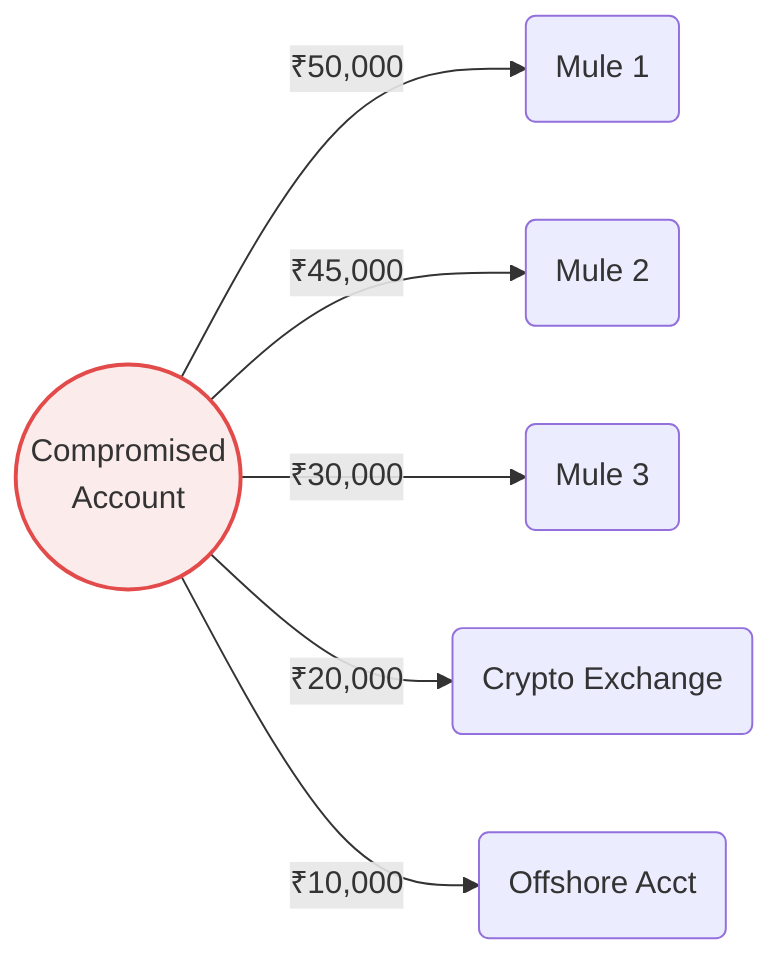
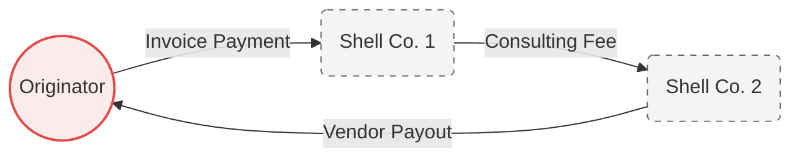
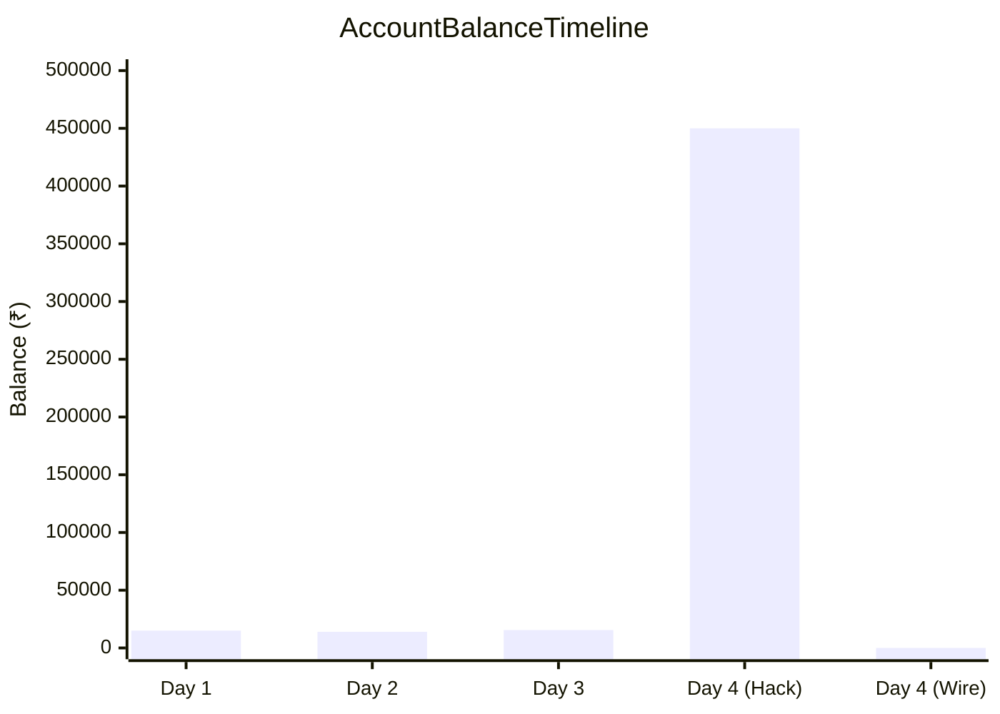
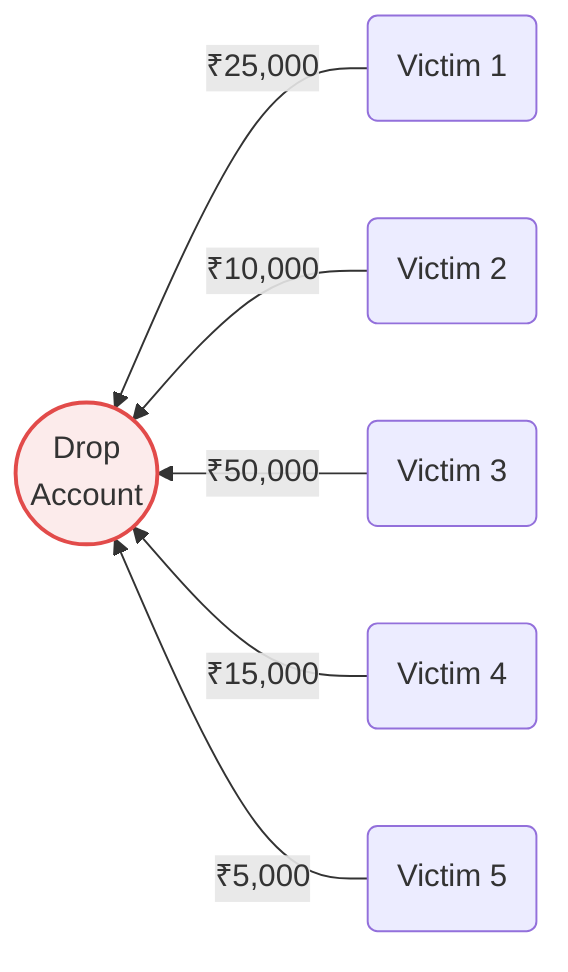
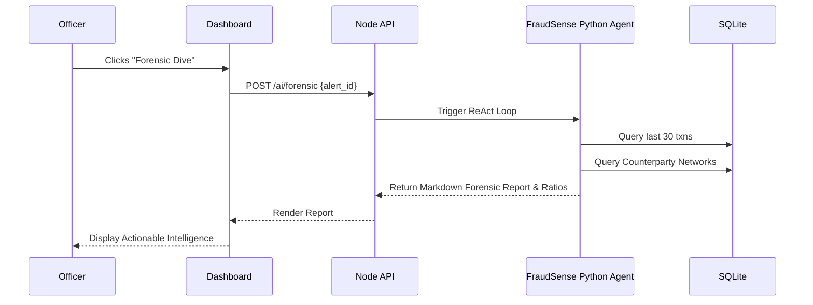

# FundTrace AI — Fraud Detection & Handling Guide

FundTrace AI incorporates a robust, real-time fraud detection engine designed to simulate advanced graph neural network (GNN) and isolation forest ensemble models. The system actively monitors all transactions, identifies suspicious patterns, calculates risk scores, and generates actionable alerts for compliance officers.

This document details the types of fraud our system detects, how these schemes are formed, and the complete lifecycle of how our project handles, records, and alerts on fraudulent activity.

---

## 🦠 Types of Fraud Detected

The FundTrace fraud engine evaluates transactions against a set of complex temporal and topological patterns. Below is a visual breakdown of the typologies currently detected by the engine.

### 1. Rapid Layering (Smurfing / Velocity Spikes)

> [!WARNING]
> **Risk Profile:** High | **Time Window:** 1 Hour | **Trigger:** ≥ 5 outbound transactions

**How it forms:** Fraudsters or money mules attempt to rapidly move illicit funds out of an account to obscure the money trail before the account can be frozen. This involves making numerous outgoing transfers in a very short time window to scatter the capital.



**Detection Logic:** The system tracks the velocity of outgoing transactions within a 1-hour window. If an account initiates 5 or more outbound transfers in an hour, it triggers a layering alert. Severity scales with the transaction count (e.g., 10+ transactions trigger maximum severity).

---

### 2. Circular Transaction Movement

> [!CAUTION]
> **Risk Profile:** Critical | **Time Window:** 72 Hours | **Trigger:** Cycle detection

**How it forms:** Money laundering schemes often involve "round-tripping" funds where money flows from an originator, through one or more intermediate shell/mule accounts, and directly back to the originator. This creates a false trail of legitimate-looking business activity.



**Detection Logic:** The engine performs a 72-hour bidirectional graph-walk. It checks if any account that the *sender* recently received money from is also an account the *receiver* recently sent money to. It also flags direct round-trips where `A` sends to `B`, and `B` returns funds to `A` within 24 hours.

---

### 3. Structuring (Threshold Evasion)

> [!IMPORTANT]
> **Risk Profile:** Medium | **Time Window:** 24 Hours | **Trigger:** Multiple txns strictly between ₹9L – ₹10L

**How it forms:** Regulatory bodies require automated reporting for transactions above a certain threshold (e.g., ₹10,00,000). To avoid tripping these automated reports, launderers will deliberately "structure" their transfers to be just below the threshold.

```mermaid
gantt
    title Structured Deposits (Evasion of ₹10L limit)
    dateFormat  HH:mm
    axisFormat  %H:%M
    
    section Account A
    Wire Transfer ₹9.8L   :crit, a1, 09:00, 5m
    Wire Transfer ₹9.5L   :crit, a2, 11:30, 5m
    Wire Transfer ₹9.9L   :crit, a3, 14:15, 5m
    
    section Threshold
    ₹10,00,000 Limit (Avoided) :milestone, m1, 14:20, 0m
```



**Detection Logic:** The system monitors for consecutive transactions that fall into the 90%–99% range of the reporting threshold. Firing 2 or more transfers between ₹9L and ₹10L within a 24-hour period immediately flags the account for structuring behavior.

---

### 4. Dormant Account Activation (Sleeper Mules)

> [!WARNING]
> **Risk Profile:** High | **Time Window:** 30+ Days Dormant | **Trigger:** First txn > ₹50,000

**How it forms:** Fraudsters often purchase or compromise legitimate accounts, leave them completely dormant to "age" the account and bypass new-account security triggers, and then suddenly use them to process high-value fraudulent transfers.

```mermaid
journey
    title Sleeper Mule Lifecycle
    section Stage 1: Compromise
      Account Taken Over: 5: Fraudster
    section Stage 2: Aging (Dormant)
      No Activity (Months): 1: System
    section Stage 3: Exploitation
      Sudden ₹5,00,000 Wire: 1: Fraudster
      Alert Triggered: 5: FundTrace AI
```

**Detection Logic:** The engine checks the historical activity of the sender. If an account initiates a high-value transfer (e.g., > ₹50,000) but has had absolutely zero activity in the preceding 30 days (or since creation), it is flagged as anomalous dormant activation.

---

### 5. Profile Mismatch (Sudden Balance Spikes)

> [!WARNING]
> **Risk Profile:** Medium | **Trigger:** Balance spikes > 5x resulting in > ₹1L balance, followed by outbound transfer

**How it forms:** A standard user account with historically low balances suddenly receives a massive influx of funds, which are then immediately wired out. This strongly indicates the account has been hijacked and is acting as a pass-through node for illicit capital.



**Detection Logic:** The engine analyzes the user's running balance prior to the transaction. If the account recently experienced a 500% (5x) increase resulting in a balance over ₹1,00,000—and is now initiating outgoing wires—it triggers a profile mismatch warning.

---

### 6. High Inflow Velocity (Drop Account Aggregation)

> [!CAUTION]
> **Risk Profile:** Critical | **Time Window:** 1 Hour | **Trigger:** ≥ 8 inbound transactions

**How it forms:** In scams (like investment fraud, romance scams, or phishing), victims are instructed to send funds to a central "drop" account or syndicate nexus. This account will suddenly experience a massive spike in inbound transfers from numerous distinct and unrelated victims.



**Detection Logic:** We monitor receiving velocity. If a recipient account sustains 8 or more distinct inbound transfers within a 1-hour window, the recipient is flagged as a potential drop/aggregation point.

---

## ⚙️ How the System Handles & Records Fraud

The fraud detection lifecycle in FundTrace is atomic, real-time, and deeply integrated into the transaction pipeline.

| Phase | Component | Action Performed |
| :--- | :--- | :--- |
| **1. Scoring** | `fraud.js` Engine | Evaluates transaction synchronously inside an SQLite transaction. Calculates Risk Score (0–100) and extracts triggered patterns. |
| **2. Recording** | `transactions` Table | Row is updated with `fraud_score` integer and `flagged = true` boolean. |
| **3. Alert Generation** | `fraud_alerts` Table | If Score > 50, a dedicated alert (`ALT-XXXXXX`) is generated with JSON metadata containing the exact logic triggered. |
| **4. Archiving** | `logger.js` | Persistent, append-only paper trail created in physical log files for external audit compliance. |

---

## 🚨 How the System Alerts Us

FundTrace AI uses a multi-channel alerting mechanism to ensure compliance officers can act rapidly:

### 1. Real-Time Socket.IO Broadcasts
When an alert is created, the Node.js backend immediately emits a `fraud_alert` event via WebSockets (`Socket.IO`) to the `officers` broadcast room.
*   Dashboards instantly display a floating notification (toast) detailing the alert ID, score, pattern, and amount.
*   The UI updates **without requiring a page refresh**.

### 2. Officer Dashboard (UI Integration)
The officer dashboard features dedicated, color-coded visual interfaces:
*   **Transaction Management Tab:** Flagged transactions show red warning badges, and a visual heat bar (0-100) immediately indicates severity.
*   **Graph Explorer (Topology visualizer):** Fraudulent accounts are rendered as critical red nodes within the interactive topology graph. The size of the node represents money volume, making fraud rings visually obvious.
*   **Fraud Alerts Tab:** A dedicated triage queue for officers to review open cases.

### 3. AI Forensic Investigator (FraudSense Autonomous Agent)
When an alert is generated, officers can leverage the **FraudSense AI Agent** via the `/ai/forensic` API endpoint to perform automated deep-dive analysis.



*   **Autonomous Investigation:** The LLM agent queries the database live, extracts the 30 most recent transactions for the flagged entity, computes ratio anomalies, and generates a plain-English forensic report.
*   **Targeted Questioning:** Officers can interact with this AI live in the investigator chat interface with 1-click contextual queries (e.g., *"Are funds being transferred to new or recently added beneficiaries?"*), which automatically routes the account context into the LLM's prompt.
